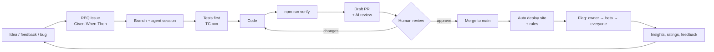

# How we build BAPO Path (AI-native workflow)

**The idea:** people decide *what* to build and *whether* it is good enough to ship. AI agents do most of the *how*:
drafting requirements, writing code and tests, reviewing. Automatic gates in CI catch what both miss.
Nothing reaches learners without passing a gate, and nothing new reaches them without a feature flag.

## The stages and their gates

| # | Stage | Who does it | Output | Gate (must pass to move on) |
| --- | --- | --- | --- | --- |
| 1 | **Capture** | Person, or the agent with `/new-requirement` | REQ issue with Given/When/Then and a TC id | A person confirms the criteria; assumptions are tagged `[ASSUMPTION]` and approved |
| 2 | **Plan** | Person | Sprint label, priority, one REQ (or a small group) per PR | The work fits in one PR, one sprint at most |
| 3 | **Build** | Agent (Claude Code), following `CLAUDE.md` | Failing TC tests first, then the code, behind a flag | `npm run verify` passes locally |
| 4 | **Verify** | CI | `ci.yml` (prompt check, build, e2e) · `rules-test.yml` (Firestore rules) | Required checks are green |
| 5 | **Review** | AI first (`claude-review.yml` or `/code-review`, `/security-review`), then a person | Review comments resolved | A person approves. Code owners approve rules and pipeline changes |
| 6 | **Release** | CI + Owner | Site to GitHub Pages; rules to Firebase after the `production` approval | Owner approves the rules deploy. The feature stays at flag audience `owner` |
| 7 | **Roll out** | Owner | Flag audience moves owner → beta → everyone (Prompt admin → Insights → Features) | No new bugs from the previous audience |
| 8 | **Learn** | Owner + agent | Insights, ratings, feedback inbox, bug issues | Findings become new REQ or bug issues (back to stage 1) |

Traceability runs through every stage: **REQ issue → `docs/requirements/` matrix → TC test → PR "Requirements covered" table → commit with the agent session link.**

---

## Flow A: one engineer (the Owner + AI agents)

For Christine working alone with Claude Code. The agent writes and checks the code; she makes the decisions and does the final read.

### Every piece of work

1. **Write the requirement** (5–15 min)
   Tell Claude the idea and run `/new-requirement`. Read the drafted criteria critically: they become the tests.
   Approve, and the issue plus a matrix row are created.
2. **Start a session on a branch**
   Use one branch per REQ or bug, e.g. `feat/req-026-…` or `fix/27-…`. Start with: *"Implement REQ-026. Follow CLAUDE.md."*
   For a bug, use `/fix-bug`: it reproduces the bug with a failing test before fixing it.
3. **Let the agent work, and check in at two points**
   - **After the tests are written:** do the TC tests match what you meant? This is the cheapest place to catch a misunderstanding.
   - **After the demo works:** open `npm run dev:demo` (or the agent's screenshots) and try it as each role with "Act as".
4. **Ship gate:** run `/ship`. It runs `verify`, the AI review and the traceability update, then opens a **draft** PR.
5. **Your review** (this one is required, even alone)
   - Wait for the CI checks to go green.
   - Read the PR description's **Not tested** and **Departures** sections first.
   - Read the whole diff of `firestore.rules`, `promptApi.js` and `firebase.js`. For the rest, skim for anything surprising.
   - Big PR? Ask the agent to split it. A good size is one you can read in about 15 minutes.
   - Mark it ready, then **Squash and merge**.
6. **Release:** the site deploys on merge. If the rules changed, approve the **production** deploy in Actions straight away:
   the site is already live, and until the rules are, anything that needs them fails. This is one more reason new features start behind a flag.
   Do any "After merging" steps from the PR.
7. **Roll out** from the flag audience `owner` to `beta` to `everyone` once you are happy. Close the REQ issue.

### Solo guard-rails

- Branch protection on `main`, even alone: required checks, no direct pushes (see setup below).
  Approving your own PR isn't possible on GitHub, so for solo work set **required approvals to 0** but keep the required checks.
- At most **2 agent sessions at once**, on different areas (for example, content and the admin). More than that and review becomes the bottleneck.
- Merge in the morning, not late at night: you'll read the diff better.
- Each week, spend 30 minutes on Dependabot PRs and on the "Gaps to close next" list in `docs/requirements/`.

---

## Flow B: a development team

For when more people join: developers, a QA or BA, content editors. Everyone works with AI agents; the same gates apply, with more people in them.

### Roles

| Role | Owns | In GitHub |
| --- | --- | --- |
| **Product Owner** (Christine) | Backlog, priorities, acceptance criteria, flag rollout, final say on scope | Writes and approves REQ issues; approves the `production` deploy |
| **Tech lead** | `CLAUDE.md`, architecture, `firestore.rules`, CI | Code owner for rules, `.github/` and `CLAUDE.md` |
| **Developers** (each with AI agents) | Build and test REQs end to end | Open PRs; review each other's PRs |
| **QA / BA** | TC quality, exploratory tests on preview builds, bug reports | Reviews the TC tests in PRs; files bugs from the template |
| **Content editors** | Prompts and glossary content | Use **Prompt admin / Knowledge admin**, not code (Editor → Reviewer workflow) |

### Sprint rhythm (2 weeks)

| When | What | AI's part |
| --- | --- | --- |
| **Refinement** (weekly, 45 min) | PO brings ideas; the team sharpens the criteria and splits big stories | The agent drafts REQs and flags vague or untestable criteria and gaps in the matrix |
| **Planning** (day 1) | Pick REQs, one owner per REQ, label `sprint-N` | The agent estimates the files touched and conflict risk between REQs |
| **Daily** | Blockers, PRs waiting for review | — |
| **Build** | One branch and one PR per REQ; tests before code | Agents write tests and code; `/ship` before each PR |
| **Review** (continuous) | PR review within one working day | AI review comments first; people focus on intent, design and security |
| **Demo** (last day) | Show the flagged features on the live site as Owner | — |
| **Retro** | What slowed us down, and what the agent got wrong | Add lessons to `CLAUDE.md` so every future session learns them |

### Team rules

- **Branch protection:** 1 approval from someone else; code-owner approval for rules and the pipeline; checks required; branch up to date before merge.
- **The author never merges their own rules change.** The tech lead or the Owner reviews `firestore.rules` line by line.
- **The AI reviews first, a person reviews last.** The person checks: does it do what the REQ means? Is it safe? Would we understand it in 6 months?
- **WIP limit:** each developer has at most 2 open PRs. Agents can work in parallel (`git worktree`, separate branches) but must not touch the same files.
  The planning step flags overlaps.
- **Shared agent memory = `CLAUDE.md` + skills in `.claude/skills/`.** Anyone who corrects an agent twice for the same thing adds a rule there in a PR.
- **Content changes go through the app**, not code, after the first import. Code PRs that change `src/data/prompts/` are only for the launch set and fallbacks.
- **Definition of done** = the checklist in `CLAUDE.md` + the PR template, plus QA/BA approval of the TC tests for Must requirements.

---

## One-time GitHub setup (Owner, about 20 minutes)

These settings live in GitHub, not in the code, so an agent can't set them for you.

1. **Settings → Branches → Add rule for `main`:**
   - Require a pull request before merging (approvals: 0 solo, 1 for a team; *Require review from Code Owners* for a team)
   - Require status checks: **Content, build and end-to-end tests** and **rules** (they show up after the first PR runs them)
   - Require branches to be up to date; block force pushes
2. **Settings → Environments → New environment `production`** → Required reviewers: yourself. Do this **before** step 3: the rules deploy refuses to run without a required reviewer.
3. **Rules deploy key (optional, removes the manual console step):** create a Firebase service account with only the *Firebase Rules Admin* role, and save its JSON as the secret `FIREBASE_SERVICE_ACCOUNT`.
   Until then `deploy-rules.yml` tests the rules and asks you to publish them in the console.
4. **AI review on PRs (optional), no API key needed:** on your computer run `claude setup-token` (needs a Claude Pro or Max plan),
   then save the token as the repository secret `CLAUDE_CODE_OAUTH_TOKEN`. Running `/install-github-app` in Claude Code does this for you.
   Reviews then count against your subscription, not paid API usage. A pay-as-you-go `ANTHROPIC_API_KEY` secret also works.
   Draft PRs are skipped: the review starts when you mark a PR "Ready for review".
5. **Settings → Code security:** switch on Dependabot alerts and secret scanning.

## Where things are

| Need | File |
| --- | --- |
| Rules for agents | `CLAUDE.md` |
| Agent skills | `.claude/skills/new-requirement`, `ship`, `fix-bug` |
| Requirements and traceability | `docs/requirements/` |
| End-to-end tests | `tests/e2e/` (`npm run test:e2e`) |
| Security rules and tests | `firestore.rules`, `tests/rules.test.mjs` |
| CI | `.github/workflows/ci.yml`, `rules-test.yml`, `deploy.yml`, `deploy-rules.yml`, `claude-review.yml` |
| PR and issue templates | `.github/pull_request_template.md`, `.github/ISSUE_TEMPLATE/` |
